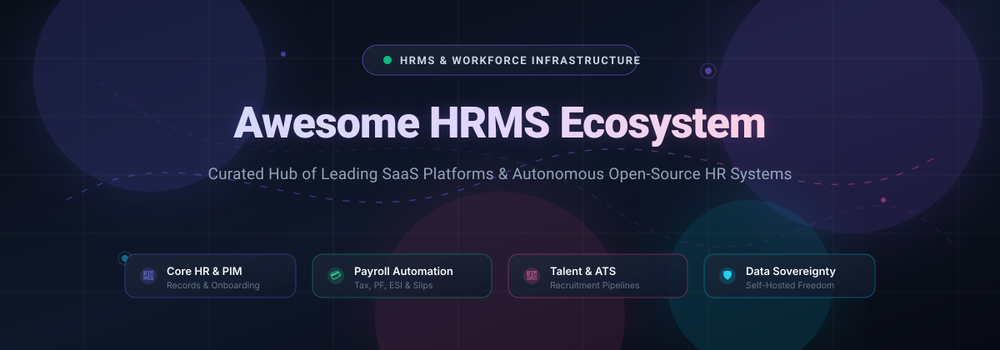

<div align="center">

<a href="https://github.com/ishandutta2007/Awesome-Human-Resources-Management-HRMS">
  
</a>

# 🏢 Awesome Human Resources Management (HRMS) & Payroll Ecosystem 💼

<p align="center">
  <strong>Curated Directory of Enterprise SaaS Suites, Modern Cloud HRIS, and Self-Hosted Open-Source Payroll &amp; Workforce Platforms</strong>
</p>

<p align="center">
  <a href="https://github.com/ishandutta2007/Awesome-Awesome-Awesome"></a>
  <a href="https://discord.gg/jc4xtF58Ve"></a>
  <a href="https://github.com/ishandutta2007/Awesome-Human-Resources-Management-HRMS/stargazers"></a>
  <a href="https://github.com/ishandutta2007/Awesome-Human-Resources-Management-HRMS/network/members"></a>
  <a href="https://github.com/ishandutta2007/Awesome-Human-Resources-Management-HRMS/blob/main/LICENSE"></a>
  <a href="https://github.com/ishandutta2007"></a>
</p>

---

<p align="center">
  <a href="#-sector-overview--market-dynamics">Sector Overview</a> •
  <a href="#-saashosted-platforms">SaaS Platforms</a> •
  <a href="#-open-source-github-projects">Open-Source HRMS</a> •
  <a href="#-how-to-contribute">Contribute</a> •
  <a href="#-star-history">Star History</a> •
  <a href="#-support--sponsorship">Support</a> •
  <a href="#-disclaimer">Disclaimer</a>
</p>

</div>

---

## 📌 Executive Summary

This repository is a production-grade, SEO-optimized index tracking premier **SaaS platforms** and **autonomous open-source projects** in the **Human Resources Management (HRMS)**, **Human Capital Management (HCM)**, **HRIS**, and **Payroll Automation** ecosystem.

These platforms empower modern People Operations (PeopleOps), HR administrators, IT departments, and engineering teams to orchestrate the complete employee lifecycle:
- 🎯 **Talent Acquisition & ATS**: Multi-stage job requisitions, candidate pipeline management, structured interviews, and digital offer rollout.
- 👥 **Core HR & Personnel Information Management (PIM)**: Employee record databases, hierarchical org charts, self-service portals, document repositories, and digital contracts.
- ⏱️ **Time, Attendance & Leave**: Geolocation check-ins, biometric device integrations (ZKTeco, Anviz), shift scheduling, PTO accruals, and audit trails.
- 💳 **Payroll, Taxation & Compliance**: Automated salary computations, multi-currency salary structures, statutory deductions (PF, ESI, TDS, Form 16, FICA, ERISA), and payslip generation.
- 📈 **Performance & Development**: OKRs, KRAs, continuous feedback, 360-degree appraisal cycles, and integrated learning management systems (LMS).
- 🛡️ **Data Sovereignty & Self-Hosting**: Enterprise-ready open-source codebases enabling self-hosted, air-gapped HR infrastructure with zero per-employee recurring fees.

---

## 🧭 Table of Contents

- [📊 Sector Overview & Market Dynamics](#-sector-overview--market-dynamics)
- [☁️ SaaS/Hosted Platforms](#-saashosted-platforms)
- [💻 Open-Source GitHub Projects](#-open-source-github-projects)
- [🤝 How to Contribute](#-how-to-contribute)
- [📈 Star History](#-star-history)
- [💖 Support & Sponsorship](#-support--sponsorship)
- [⚖️ Disclaimer](#-disclaimer)

---

## 📊 Sector Overview & Market Dynamics

The global Human Resources Management Software (HRMS / HCM) market represents a rapidly growing software category valued between **$20 billion and $27 billion**, compounding at a **CAGR of 11% to 14%** toward an anticipated valuation exceeding **$55+ billion** over the next decade.

The sector exhibits a bifurcated competitive structure:
* **Enterprise Tier (Moderately Consolidated / Oligopolistic)**: Global multinational corporations with multi-jurisdiction compliance and complex accounting layers rely heavily on consolidated suites such as Workday, SAP SuccessFactors, and Oracle HCM Cloud, which command a dominant share of enterprise spend.
* **Mid-Market & SMB Tier (Highly Fragmented)**: For businesses below 5,000 employees, the space is vibrant and fiercely contested by cloud-native all-in-one HRIS platforms (e.g., Rippling, Gusto, BambooHR, Personio, Zoho People), modular vertical tools, and self-hosted open-source software (e.g., Frappe HR, Horilla, Odoo). Low barriers to SaaS deployment keep this tier exceptionally competitive rather than "winner-take-all."

---

## ☁️ SaaS/Hosted Platforms

The following SaaS suites are ranked in descending order based on enterprise company scale (market capitalization, valuation, and annual revenue).

| Product | Scale (Revenue / Valuation) | Core Capabilities & Description | Pricing (Starting) | Free Tier / Trial Limits |
|---------|-----------------------------|---------------------------------|-------------------|--------------------------|
| **[Workday HCM](https://www.workday.com/)** | ~$45B–$48B Market Cap (~$9.55B FY25 Revenue) | 🌐 Enterprise HCM benchmark spanning core HR, global payroll, workforce planning, talent optimization, and analytics. FSE-based pricing weights worker tiers differently. | Entry contracts start at ~$35–$42 PEPM for enterprise scale (or ~$80–$100+ PEPM for sub-1k employee tiers; multi-year minimum) | No free tier or trial for Core HCM; scheduled interactive demo via sales only |
| **[Rippling](https://www.rippling.com/)** | $16.8B Valuation (~$1.0B ARR) | ⚡ Compound workforce platform unifying HRIS, global payroll, benefits, corporate spend cards, and IT device/app provisioning into a single employee database. | Core platform starts at $8/employee/month (plus ~$35–$40/month platform base fee) | No public free trial for regular accounts; qualified early-stage startups can apply for up to 6 months free |
| **[Zoho People](https://www.zoho.com/people/)** | ~$12.5B Implied Valuation (~$1.5B Revenue) | 📊 Cloud HRIS within the Zoho ecosystem featuring employee onboarding, attendance, time tracking, leave approvals, and employee self-service. | **$1.25/employee/month** (Essential HR plan, billed annually) or $1.50/employee/month (monthly billing) | **Free tier forever for up to 5 users**; paid plans offer a **30-day free trial** |
| **[Gusto](https://gusto.com/)** | $9.3B Valuation (~$1.0B TTM Revenue) | 💰 Small-business payroll and benefits platform with automated local/federal tax filings, direct deposits, health insurance, and 401(k) integrations. | **$49/month base fee + $6/employee/month** (Simple plan) or $35/month + $6/contractor for contractor-only | Free account setup and dashboard access with no time limit; billed only upon running first live payroll |
| **[Personio](https://www.personio.com/)** | $8.5B Valuation (~$350M–$430M ARR) | 🇪🇺 European HRIS designed for SMBs, offering unified personnel records, absence management, preliminary payroll, and recruitment workflows. | Core plan starts at **€7.60–€9.00 (~$8.00–$9.50)/employee/month** (annual contract; onboarding fee applies) | **14-day free trial** (full access with sample data, no credit card required) |
| **[BambooHR](https://www.bamboohr.com/)** | $1.0B+ Valuation (~$270M–$350M ARR) | 🎋 Leading SMB-focused HR platform with intuitive personnel files, time-off approvals, employee satisfaction (eNPS), and visual org charts. | **$10/employee/month** (Core plan; optional add-ons like Payroll and Time Tracking extra) | **7-day free trial** (unlimited access to core HR features, no credit card required) |

---

## 💻 Open-Source GitHub Projects

Self-hosted and open-source HRMS software eliminates compounding per-seat SaaS costs, guarantees strict local data sovereignty under GDPR/statutory rules, and provides customizability across internal databases.

The projects below are ranked in descending order by **GitHub Star Count**. Every badge links directly to that repository's stargazer network.

| Project | Stars | Tech Stack | License | Description & Key Modules |
|---------|-------|------------|---------|---------------------------|
| **[Odoo](https://github.com/odoo/odoo)** | [](https://github.com/odoo/odoo/stargazers) | Python, JavaScript | LGPL-3.0 | 🌟 **Comprehensive Business Suite with Core HR.** Features employee profiles, department hierarchies, leave requests, attendance, timesheets, and basic recruitment. Seamlessly connects with Odoo CRM, Project, and Accounting. Advanced enterprise payroll requires proprietary modules. |
| **[ERPNext](https://github.com/frappe/erpnext)** | [](https://github.com/frappe/erpnext/stargazers) | Python, JavaScript (Frappe Framework) | GPL-3.0 | 🚀 **Flagship Open-Source ERP & Enterprise HR System.** Complete ERP platform with comprehensive human resources management: employee lifecycles, recruitment, job requisitions, training, appraisals, asset assignments, and accounting-integrated expense claims. |
| **[Frappe HR](https://github.com/frappe/hrms)** | [](https://github.com/frappe/hrms/stargazers) | Python, Vue.js, Frappe | GPL-3.0 | 🏆 **The Gold Standard Dedicated Open-Source HRMS & Payroll.** 13+ production modules: employee onboarding, geolocation & biometric attendance, multi-tier expense claim workflows, KRA performance appraisals, and complete payroll processing with customizable tax slabs. Includes native mobile/PWA interfaces. |
| **[Gauzy](https://github.com/ever-co/gauzy)** | [](https://github.com/ever-co/gauzy/stargazers) | TypeScript, Angular, NestJS | AGPL-3.0 | ⏱️ **Modern ERP, HRM & Workforce Management Platform.** Tailored for distributed remote teams and agencies. Includes multi-tenant time tracking, employee scheduling, expense claims, invoice generation, contractor management, and project profitability analytics. |
| **[Horilla HR](https://github.com/horilla/horilla-hr)** | [](https://github.com/horilla/horilla-hr/stargazers) | Python (Django 5), Tailwind CSS, HTMX | Apache-2.0 | 🇮🇳 **Modern HRMS with Built-in Indian Statutory Compliance.** 40+ out-of-the-box modules: PF, ESI, TDS, Form 16, professional tax, biometric hardware integration (ZKTeco/Anviz), visual drag-and-drop recruitment pipelines, 360° appraisals, and asset tracking with multi-company isolation. |
| **[OrangeHRM](https://github.com/orangehrm/orangehrm)** | [](https://github.com/orangehrm/orangehrm/stargazers) | PHP, MySQL | GPL-2.0 | 🏛️ **The Pioneer Free & Open-Source HRMS.** Battle-tested platform offering Personnel Information Management (PIM), employee self-service dashboards, leave management, time tracking, and customizable reporting. Advanced modules available in commercial editions. |
| **[OpenCATS](https://github.com/opencats/OpenCATS)** | [](https://github.com/opencats/OpenCATS/stargazers) | PHP, JavaScript, MySQL | GPL-2.0 | 🎯 **Specialized Open-Source Applicant Tracking System (ATS).** Designed for internal talent acquisition teams and recruiting agencies. Manages candidate pipelines, resume parsing, job orders, interview logs, candidate ratings, and vacancy listings. |
| **[IceHrm](https://github.com/gamonoid/icehrm)** | [](https://github.com/gamonoid/icehrm/stargazers) | PHP, JavaScript | Apache-2.0 | ❄️ **Lightweight Modular HR & Attendance Platform.** Clean responsive interface covering employee database management, leave accrual policies, attendance tracking, document generation, and digital signature requests. |
| **[Euron Open HRMS](https://github.com/euron-sde-team/euron-open-hrms)** | [](https://github.com/euron-sde-team/euron-open-hrms/stargazers) | Python, FastAPI, Docker | MIT | 🔐 **Enterprise Multi-Tenant HRMS with Encrypted PII.** Engineered for platform teams and MSPs. Features country payroll rule packs across 24 countries, QR-verified payslip PDFs, and workspace cryptographic data isolation where PII is sealed with AES-256-GCM before storage. |
| **[Sentrifugo](https://github.com/sentrifugo/sentrifugo)** | [](https://github.com/sentrifugo/sentrifugo/stargazers) | PHP, MySQL | GPL-3.0 | 📋 **Configurable On-Premises HR Solution.** End-to-end personnel management without feature gating: employee records, performance appraisals, background verification workflows, disciplinary incident tracking, policy management, and exit interview modules. |

---

## 🛠️ Architecture & Deployment Guide: Choosing the Right Solution

```
                            ┌────────────────────────────────────────┐
                            │ What is your primary HR infrastructure │
                            │              requirement?              │
                            └───────────────────┬────────────────────┘
                                                │
                 ┌──────────────────────────────┴──────────────────────────────┐
                 ▼                                                             ▼
     ┌───────────────────────┐                                     ┌───────────────────────┐
     │ Enterprise Cloud SaaS │                                     │ Self-Hosted / FOSS    │
     │ Zero Ops / Managed    │                                     │ Data Sovereignty/Zero │
     └───────────┬───────────┘                                     │ Recurring Seat Fees   │
                 │                                                 └───────────┬───────────┘
       ┌─────────┴─────────┐                                                   │
       ▼                   ▼                                   ┌───────────────┴───────────────┐
┌─────────────┐     ┌─────────────┐                            ▼                               ▼
│ Enterprise  │     │ SMB / Scale │                  ┌───────────────────┐           ┌───────────────────┐
│ Workday     │     │ Rippling    │                  │ Complete Payroll  │           │ Agency / Remote   │
│ HCM         │     │ Gusto / Zoho│                  │ & Core HR Suite   │           │ Time & Resource   │
└─────────────┘     └─────────────┘                  └─────────┬─────────┘           └─────────┬─────────┘
                                                               │                               │
                                                   ┌───────────┴───────────┐                   ▼
                                                   ▼                       ▼             ┌───────────┐
                                            ┌─────────────┐         ┌─────────────┐      │ Gauzy     │
                                            │ Frappe HR   │         │ Horilla HR  │      └───────────┘
                                            │ (Global/ERP)│         │ (India Spec)│
                                            └─────────────┘         └─────────────┘
```

---

## 🤝 How to Contribute

Contributions from HR practitioners, PeopleOps managers, and software developers are warmly welcome!

1. 🍴 **Fork** this repository.
2. 🌿 Create a new topic branch: `git checkout -b feature/add-new-hrms-tool`.
3. 📝 Update `README.md` following the exact table structure (Name, Star Badge linking to stargazers, Tech Stack, License, and factual description).
4. ✅ Ensure links are active and pricing/open-source claims are verifiable.
5. 🚀 Push to your branch and open a **Pull Request**.

---

## 📈 Star History

[](https://www.star-history.com/#ishandutta2007/Awesome-Human-Resources-Management-HRMS&type=date&legend=top-left)

---

## 💖 Support & Sponsorship

If this curated repository saved you hours evaluating HR tools, choosing software for your company, or architecting a self-hosted HRMS deployment, please consider supporting the project:

- ⭐ **Star this repository** on GitHub to amplify visibility.
- 🍴 **Fork and share** it with your PeopleOps, HR tech, and engineering communities.
- ☕ **Buy a coffee & sponsor ongoing maintenance** via the [GitHub Sponsors Dashboard](https://github.com/sponsors/ishandutta2007).

Your support enables continuous tracking, benchmarking, and curation of the modern HRMS ecosystem!

---

## ⚖️ Disclaimer

- This curated list is maintained for educational and technical evaluation purposes; inclusion does not constitute a commercial endorsement.
- HRMS, HRIS, and Payroll platforms process sensitive employee Personally Identifiable Information (PII), salary history, banking accounts, and national tax identifiers. Always enforce TLS encryption in transit, AES encryption at rest, stringent role-based access control (RBAC), and strict compliance with local regulations (GDPR, HIPAA, ERISA, Indian IT Act, SOC 2).

---

<div align="center">
  <sub>Maintained with ❤️ for HR administrators, people operations teams, and engineers architecting workforce systems worldwide.</sub>
</div>
